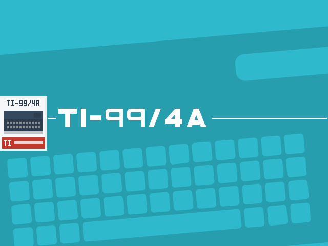
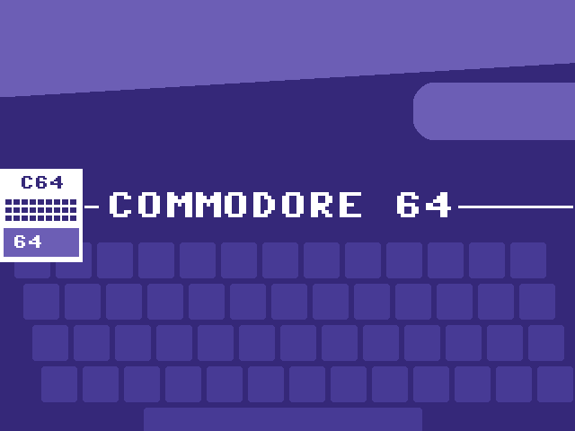
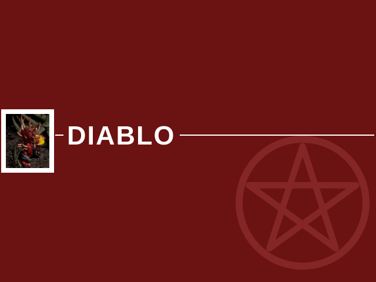
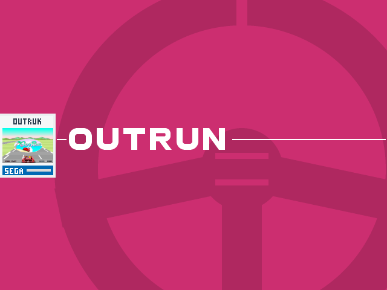
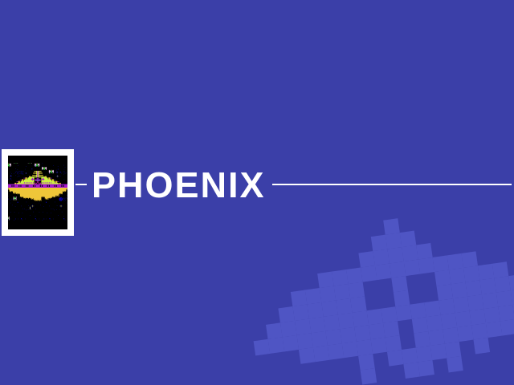
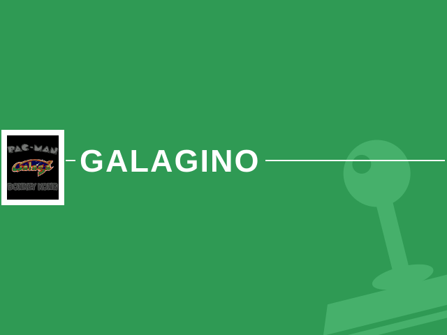
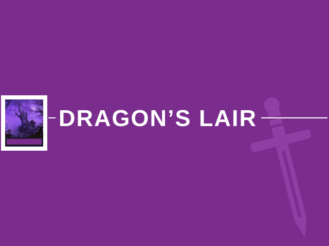
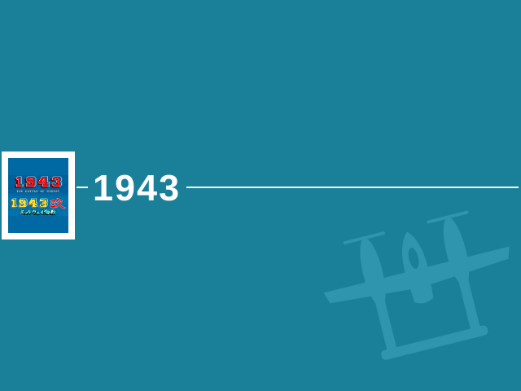
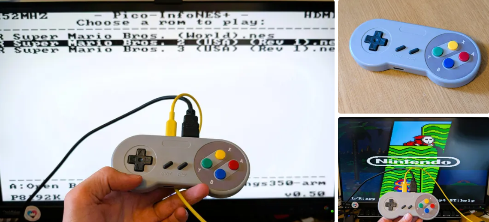

# pico-bootLoader


pico-bootLoader is a bootloader for RP2350 boards. Its primary purpose is to
host a collection of retro-game emulators and native ports of *Doom*,
*Duke Nukem 3D*, *Quake II* and *Diablo* on a single board and to let the user choose which one to run
from an on-screen menu, without reconnecting the board to a computer.

It runs on ten board configurations, each with its own ready-made binary — see
[Supported hardware](#supported-hardware) for the file names:

- Raspberry Pi Pico 2 / Pico 2 W, or a Pimoroni Pico Plus 2, with an Adafruit DVI
  breakout and a microSD breakout — or the [PicoNES PCB](#picones-pcb-hw_config-2)
  that replaces that wiring
- Raspberry Pi Pico 2 / Pico 2 W on a Pimoroni Pico DV Demo Base
- Adafruit Fruit Jam
- Adafruit Metro RP2350
- Adafruit Feather RP2350 with a TLV320DAC3100
- Waveshare RP2350-Zero with the [PicoNES Mini PCB](#picones-mini-pcb-hw_config-6)
- Waveshare RP2350-PiZero
- Waveshare RP2350-USB-A, optionally on the
  [PicoNES Micro PCB](#picones-micro-pcb-hw_config-9)
- Murmulator M2, or an RP2350 Plus on the
  [PicoSNES PCB](#picosnes-pcb-hw_config-13), which uses the same pin map
- [Olimex RP2040-PICO-PC](#olimex-rp2040-pico-pc-hw_config-15) with a Raspberry
  Pi Pico 2

Every one of them outputs video over DVI/HDMI and reads its applications from an
SD card. RP2040 boards are not supported: the flash layout and the UF2 checks are
RP2350-specific. The Olimex board is named after the RP2040 Pico it was designed
for, but takes a Pico 2 in the same socket. The four PCBs are optional
console-style carriers for boards already in this list — see
[Custom PCBs](#custom-pcbs).

It is not limited to emulation, though: any RP2350 application can be made
bootable and added to the menu — see [Creating a bootable build of your own
application](#creating-a-bootable-build-of-your-own-application).

An RP2350 board normally holds a single program. Running a different one means
connecting it to a PC, holding BOOTSEL, and copying a new `.uf2` over USB.
pico-bootLoader replaces that procedure: the applications are placed on the
board's SD card once, and from then on every power-on presents a menu. The menu
is navigated with a USB game controller or a USB keyboard, in either a graphical
mode with full-screen artwork per application or a plain text mode. Selecting an
entry flashes the corresponding application (if it is not already resident) and
starts it. A hardware reset or power cycle always returns to the menu.

*Doom*, *Duke Nukem 3D*, *Quake II* and *Diablo* are included as native RP2350 ports —
they are **not** emulated.

## Getting started

1. **Flash the bootloader.** Download the loader `.uf2` for your board from the
   [Releases](https://github.com/PicoPlus-devel/pico-bootLoader/releases) page;
   the table under [Supported hardware](#supported-hardware), below, gives the
   file name for each board. Hold BOOTSEL, connect the board over USB, and copy
   the `.uf2` onto the `RP2350` drive.
2. **Prepare the SD card.** Use a FAT32-formatted card (exFAT also works, but is
   not advised), and insert it into the computer.

   **On Windows, `updateAll` prepares the whole card.** Download
   `updateAll-<version>.exe` from the most recent release on the Releases page
   that holds it; a release holds it only when the program changed. The program
   needs no installation and can be started from any folder. Windows may report
   that the program is not signed: select **More info**, then **Run anyway**.
   The program selects the first removable drive that holds a pico-bootLoader
   card, or else the first removable drive, so check the **SD card** field; the
   program warns when that drive holds files but no pico-bootLoader card. The
   **SD card files** row starts ticked, and installs
   `pico-bootLoader_sdcard.zip`: the emulators, the native ports, the menu
   artwork, a sample configuration file and a copy of `updateAll`. The rows of the
   shareware or demo data of *Doom*, *Duke Nukem 3D*, *Quake II* and *Diablo* start
   ticked too; *Doom* does not start without its data. The rows of the arcade ROM
   sets and the BIOS files of the emulators are unticked at every start. Tick the
   ones you want, then select **Install**.

   `updateAll` installs each in the folder its application reads, and downloads
   whatever is not at hand. [updateAll/README.md](updateAll/README.md) describes how to use only zips you
   already have. Running it again later shows the sets added since, and reports
   and installs a newer SD-card archive. That overwrites the files on the card
   that the archive also holds, including custom artwork under the same name;
   the Windows program asks first, and a menu list you edited is saved as `.bak`.
   See [SD-card archive](updateAll/README.md#sd-card-archive).

   **Copyright.** The ROM sets and BIOS files are copyright of their
   manufacturers and are not part of this project. Holding the rights to them is
   your responsibility. `updateAll` reminds you of this when they are selected.

   **To prepare the card by hand,** which is the way on Linux or macOS, download
   `pico-bootLoader_sdcard.zip` from the same Releases page and unpack it onto
   the card. Then run `updateAll` from the card's `updateAll` folder to install
   the rest: `updateAll.exe` on Windows, which selects that card itself, or
   `python3 updateAll.py --sd <path of the card>` on Linux or macOS, which asks
   whether to install the BIOS files, the arcade ROM sets and the game data. A
   copy of the script in another folder, with its `updateAll.json`, also offers to
   install the archive on a card without an `emu` folder.
   Alternatively, assemble the layout yourself as described in
   [SD card layout](#sd-card-layout).
3. **Add your games.** The archive contains no games, ROMs or BIOS files. Each
   emulator's file browser opens in its own folder: `/roms/NES`, `/roms/SNES`,
   `/roms/MD` (Genesis / Mega Drive), `/roms/PCE`, `/roms/GB`, `/roms/SMS`
   (Master System and Game Gear), `/roms/O2E` (Videopac), `/roms/TI99` or
   `/roms/C64`, and at the root of the card when that folder does not exist.
   The BIOS files and the folders of *ColecoVision*, *Doom*, *Duke Nukem 3D*,
   *Quake II*, *Diablo* and the arcade games are given under
   [Bootable applications](#bootable-applications).
4. **Run it.** Insert the card and power on the board. The menu appears.

The Releases page provides three kinds of download: the per-board bootloader
`.uf2` binaries, the `pico-bootLoader_sdcard.zip` SD-card archive and, on
releases where the program changed, the standalone `updateAll-<version>.exe`.

Release tags say which of the two changed:

| Tag | What changed | What you need to do |
| --- | --- | --- |
| `v0.N` | bootloader firmware | re-flash the board **and** refresh the SD card |
| `v0.N.M` | emulator binaries only | replace `/emu` on the SD card; no re-flash needed |

`updateAll` does the SD-card part: it reports a newer archive and installs it on
the card. It does not flash the board, and on a card already in use it says so
when a release needs it.

Every release lists the exact emulator versions its archive ships, and the same
table is in `/emu/versions.txt` on the card.

## Supported hardware

Only RP2350 boards are supported; the partition scheme and the UF2 family checks
are RP2350-specific. The board is selected at compile time through the
`HW_CONFIG` value (defined in
[`pico_shared/BoardConfigs.cmake`](pico_shared/BoardConfigs.cmake)). The same
number names the SD-card folder the loader reads applications from
(`<BASEDIR>/<HW_CONFIG>/`).

| HW_CONFIG | Board | Bootloader binary |
|---|---|---|
| 1 | Pimoroni Pico DV Demo Base (Pico 2 / Pico 2 W) | `pico-bootLoader_PimoroniDVI_pico2_arm.uf2` |
| 2 | Adafruit DVI + microSD breakout, or the [PicoNES PCB](#picones-pcb-hw_config-2) (Pico 2 / Pico 2 W / Pimoroni Pico Plus 2) | `pico-bootLoader_AdafruitDVISD_pico2_arm.uf2` |
| 5 | Adafruit Metro RP2350 | `pico-bootLoader_AdafruitMetroRP2350_arm.uf2` |
| 6 | Waveshare RP2350-Zero with the [PicoNES Mini PCB](#picones-mini-pcb-hw_config-6) | `pico-bootLoader_WaveShareRP2350ZeroWithPCB_arm.uf2` |
| 7 | Waveshare RP2350-PiZero | `pico-bootLoader_WaveShareRP2350PiZero_arm_piousb.uf2` |
| 8 | Adafruit Fruit Jam | `pico-bootLoader_AdafruitFruitJam_arm_piousb.uf2` |
| 9 | Waveshare RP2350-USB-A (optionally on the [PicoNES Micro PCB](#picones-micro-pcb-hw_config-9)) | `pico-bootLoader_WaveShare2350USBA_arm_piousb.uf2` |
| 13 | Murmulator M2, or an RP2350 Plus on the [PicoSNES PCB](#picosnes-pcb-hw_config-13) | `pico-bootLoader_MurmulatorM2_arm.uf2` |
| 14 | Adafruit Feather RP2350 (TLV320DAC3100 audio) | `pico-bootLoader_AdafruitFeatherRP2350_TLV320DAC3100_arm_piousb.uf2` |
| 15 | Olimex RP2040-PICO-PC with a Raspberry Pi Pico 2 | `pico-bootLoader_OlimexPicoPC_arm.uf2` |

Video output is DVI/HDMI on all boards. Boards whose video connector is wired
to the RP2350 HSTX pins — HW_CONFIG 2, 5, 8, 13, 14 and 15 — drive it through the
HSTX peripheral; the others use PicoDVI. A single SD card
serves both kinds — artwork is cached in both pixel formats (see
[Artwork](#artwork)).

### Olimex RP2040-PICO-PC (HW_CONFIG 15)

The [Olimex RP2040-PICO-PC](https://www.olimex.com/Products/MicroPython/PICO/RP2040-PICO-PC/)
is a carrier board for a Raspberry Pi Pico, with HDMI, a microSD slot, a USB-A
port, an audio jack and a UEXT connector. Despite its name, the loader runs on
it with a **Raspberry Pi Pico 2** in the socket in place of the original Pico.
Flash `pico-bootLoader_OlimexPicoPC_arm.uf2` and put the applications in
`/emu/15/`.

- **Video and sound.** HDMI is driven through HSTX. Sound plays on HDMI and on
  the audio jack at the same time.
- **Controllers.** A USB controller or keyboard goes in the USB-A port, and a
  NES or SNES controller can be wired to the UEXT connector. The USB-A port is
  connected to the Pico 2's own USB port, so a USB controller cannot be used
  while the card is shown to a computer in [USB drive mode](#usb-drive-mode);
  leave that mode from the NES/SNES controller or by ejecting the drive.
- **Flash.** A standard Pico 2 has 4 MB of flash, which leaves 3.5 MB for the
  application partition.
- **PSRAM.** A standard Pico 2 has no PSRAM. A PSRAM chip can be added with its
  chip-select pin on GPIO 8. Without it, the entries that require PSRAM — the
  Super Nintendo emulator, *PCEngine CD*, *OutRun*, *Duke Nukem 3D* and
  `doom_tiny_full` — still appear in the menu but do not run.

Support for this board was contributed by
[DnCraptor](https://github.com/DnCraptor).

### Pico 2 W

The Pico 2 W runs the ordinary `pico2` binary for its hardware configuration;
there is no separate build for it. Up to v0.4 there was one, purely so that the
on-board LED would work: that LED hangs off the wireless chip and reaching it
means linking the CYW43 driver, which filled the 512 KB bootloader partition to
within a few kilobytes and left no room for USB drive mode.

Everything on the board therefore works as it does on a Pico 2, except the
on-board LED, which no longer blinks as a heartbeat or while an application is
being flashed. A build with the LED can still be produced locally with
`./bld.sh -2 -c <HW_CONFIG> -w`; it is not released and USB drive mode is off in
it by default.

## Video

*Click the image below to watch pico-bootLoader in action.*

[](https://www.youtube.com/watch?v=X-7ZBaCIoeQ)


## Bootable applications

The following emulators and native ports are supported. Each is built from
its own repository and identified by the program name embedded in its `.uf2`.

| System | Program name | Source repository | Menu artwork |
|---|---|---|---|
| Nintendo Entertainment System | `piconesPlus` | [pico-infonesPlus](https://github.com/PicoPlus-devel/pico-infonesPlus) | |
| Super Nintendo Entertainment System | `picosnesPlus` | [pico-snesPlus](https://github.com/PicoPlus-devel/pico-snesPlus) |  |
| Sega Genesis / Mega Drive | `picogenesisPlus` | [pico-genesisPlus](https://github.com/PicoPlus-devel/pico-genesisPlus) |  |
| NEC PC Engine / PCEngine CD | `picopcePlus` | [pico-pcePlus](https://github.com/PicoPlus-devel/pico-pcePlus) |  |
| Nintendo Game Boy / Game Boy Color | `PicoPeanutGB` | [pico-peanutGB](https://github.com/PicoPlus-devel/pico-peanutGB) |  |
| Sega Master System / Game Gear | `picosmsPlus` | [pico-smsplus](https://github.com/PicoPlus-devel/pico-smsplus) | |
| Philips Videopac / Magnavox Odyssey² | `picoPacPlus` | [pico-pacPlus](https://github.com/PicoPlus-devel/pico-pacPlus) | |
| ColecoVision | `colecojam` | [Adafruit_ColecoJam](https://github.com/cogliano/Adafruit_ColecoJam) |  |
| Texas Instruments TI-99/4A | `pico994A` | [pico-994A](https://github.com/PicoPlus-devel/pico-994A) |  |
| Commodore 64/128 | `picoC64` | [pico-c64](https://github.com/PicoPlus-devel/pico-c64) |  |
| **Doom** (native port, not emulated) | `doom_tiny` | [pico-doom](https://github.com/PicoPlus-devel/pico-doom) | |
| **Duke Nukem 3D** (native port, not emulated) | `duke3d_game` | [pico-duke3D](https://github.com/PicoPlus-devel/pico-duke3D) |  |
| **Quake II** (native port, not emulated) | `pico-quake2` | [pico-quake2](https://github.com/PicoPlus-devel/pico-quake2) |  |
| **Diablo** (native port of DevilutionX, not emulated) | `pico-lutionX` | [pico-lutionX](https://github.com/PicoPlus-devel/pico-lutionX) |  |
| **OutRun** (native port, not emulated) | `picoOutRun` | [pico-outrun](https://github.com/PicoPlus-devel/pico-outrun) |  |
| **Phoenix** (arcade) | `picoPhoenix` | [pico-phoenix](https://github.com/PicoPlus-devel/pico-phoenix) |  |
| **Moon Cresta** (arcade) | `picoMoonCresta` | [pico-mooncresta](https://github.com/PicoPlus-devel/pico-mooncresta) |  |
| **Galagino** (arcade: 47 games, among them Pac-Man, Galaga, Donkey Kong and Xevious) | `picoGalagino` | [pico-galagino](https://github.com/PicoPlus-devel/pico-galagino) |  |
| **Dragon's Lair** (arcade, laserdisc) | `picoDragonsLair` | [pico-dragonslair](https://github.com/PicoPlus-devel/pico-dragonslair) |  |
| **1943** (arcade: 1943 and 1943 Kai) | `pico1943` | [pico-1943](https://github.com/PicoPlus-devel/pico-1943) |  |
| **Salamander** (arcade: Salamander and Lifeforce) | `picoSalamander` | [pico-salamander](https://github.com/PicoPlus-devel/pico-salamander) |  |

The following emulators need a BIOS. `updateAll` installs all of them; see
[BIOS files](updateAll/README.md#bios-files) in its README. To supply them
yourself, copy them to the folders given:
- *Nintendo Entertainment System*: for Famicom Disk System games,
  `/bios/fds-bios.rom`.
- *Philips Videopac / Magnavox Odyssey²*: the Odyssey² BIOS in `/bios`, for
  example as `o2rom.bin`. The emulator recognises it by its contents, not by
  its name.
- *PCEngine CD*: a System Card BIOS in `/bios`, as a `.pce` file, for example
  `Super CD-ROM System (Japan) (v3.0).pce`.
- *Sega Genesis / Mega Drive*: for Sega CD discs, a Sega CD or Mega-CD BIOS of
  the disc's region in `/bios`, for example `Sega CD 2 (USA) (v2.00).md`.
- *Texas Instruments TI-99/4A*: `994aROM.bin` and `994aGROM.bin` in `/bios`,
  both required — nothing runs without them. `994aDISK.bin` (disk controller)
  and `spchrom.bin` (speech vocabulary) are optional.
- *Commodore 64/128*: the BASIC, KERNAL and character ROMs in
  `/bios`, as `c64basic.rom`, `c64kernal.rom` and `c64chargen.rom`,
  and the 1541 drive ROM as `1541.rom`; for the C128, `c128basic.rom`,
  `c128kernal.rom`, `c128chargen.rom`, `c128c64.rom` and `1571.rom`. The
  [pico-c64 README](https://github.com/PicoPlus-devel/pico-c64#rom-files)
  lists the other names and folders it accepts.
- *ColecoVision*: `/coleco/COLECO.BIN`; see below.

*TI-99/4A* is built for every board the loader supports. Cartridges go in
`/roms/TI99` as `.rpk` Rom PacKs (preferred — one file per cartridge) or as the
classic C/D/G `.bin` sets; the emulator's own `tools/mkrpk.py` converts between
them. TI BASIC is reachable without a cartridge. A USB keyboard acts as the TI
keyboard, and joysticks come from USB gamepads, NES/SNES pads or Wii
controllers. **PSRAM** is not required, but without it the disk drives are
unavailable and cartridge ROM is capped at 32 KB.

*Commodore 64/128* is built for every board the loader supports. Programs
(`.prg`, `.t64`), disk images (`.d64`, `.g64`, and `.d71` for the Commodore 128),
tapes (`.tap`) and cartridges (`.crt`) go in `/roms/C64`. The file
`C64 BASIC.c64`, created in that folder at start-up, starts BASIC with nothing
loaded. A USB keyboard acts as the Commodore keyboard, and joysticks come from
USB gamepads, NES/SNES pads, Wii controllers or the numeric keypad. **PSRAM** is
not required for the Commodore 64: without it, the ROM files are copied from the
SD card into flash at the first start, and a cartridge is written to flash before
it starts. The Commodore 128 needs both **HSTX** video and **PSRAM**; on other
boards its entries and `.d71` files are not offered. The emulation is PAL only.
Only the Adafruit Fruit Jam (HW_CONFIG 8) and the Adafruit DVI + MicroSD breakout
combination (2) have been tried on real hardware; the
[pico-c64 README](https://github.com/PicoPlus-devel/pico-c64#supported-boards)
gives the state of each board.

*ColecoVision* runs on the Adafruit Fruit Jam (HW_CONFIG 8) only. The emulator,
[Adafruit_ColecoJam](https://github.com/cogliano/Adafruit_ColecoJam), is
written and maintained by Dan Cogliano ([@cogliano](https://github.com/cogliano))
outside this project. It expects everything in `/coleco/` on the SD
card: the 8 KB ColecoVision BIOS as `COLECO.BIN`, and the games as `.ROM` files.
Neither the BIOS nor any game is included; `updateAll` installs the BIOS.

*Doom* runs on five boards: Adafruit Fruit Jam (HW_CONFIG 8), the Adafruit DVI +
MicroSD breakout combination (2), Murmulator M2 (13), Adafruit Feather RP2350
with a TLV320DAC3100 (14) and the Olimex RP2040-PICO-PC with a Pico 2 (15). It
ships in two variants: `doom_tiny`, the shareware
episode, whose WAD the loader flashes together with the engine from a data
image, `/roms/doom/doom1-whx-bootloader.uf2` (see
[Auxiliary data images](#auxiliary-data-images)); and
`doom_tiny_full`, registered/Ultimate DOOM, which carries no WAD in flash and
instead reads `/roms/doom/doom.whd` from the SD card at boot, so it needs a board
with PSRAM. The data image is not in the SD-card archive: `updateAll` makes it
from the shareware WAD in the
[pico-doom](https://github.com/PicoPlus-devel/pico-doom) repository and
installs it in `/roms/doom/`. It is the same file for every board. Without it,
the menu names the missing file instead of starting the game.

*Duke Nukem 3D* runs on four boards: Adafruit Fruit Jam (HW_CONFIG 8), the
Adafruit DVI + MicroSD breakout combination (2, on a Pimoroni Pico Plus 2),
Murmulator M2 (13) and the Olimex RP2040-PICO-PC with a Pico 2 (15, with a PSRAM
chip fitted on GPIO 8). It needs **PSRAM** on all four. There is no companion data
image: `DUKE3D.GRP` — shareware or registered/Atomic — is streamed from
`/roms/duke3d/` on the SD card, with savegames and `duke3d.cfg` written next to
it. `updateAll` installs the shareware version 1.3d there. All four have been
tested on hardware.

*Quake II* runs on two boards: Adafruit Fruit Jam (HW_CONFIG 8) and the Adafruit
DVI + MicroSD breakout combination (2, on a Pimoroni Pico Plus 2). It needs 8 MB
of **PSRAM** and 16 MB of flash. The game data is not included: `updateAll`
installs the demo, or download `pico-quake2_demo_sdcard.zip` from the
[pico-quake2 releases](https://github.com/PicoPlus-devel/pico-quake2/releases)
and unpack it to the root of the card, which puts `pak0.pak` in
`/roms/quake2/baseq2/`; the `baseq2` folder of the full game goes in the same
place. Savegames and settings are written there too. The first load of each
level copies its textures, models and sounds from the card into flash, above the
application, and takes considerably longer than later loads. Other applications
may overwrite that copy; it is then refreshed on the next load. On HW_CONFIG 2,
*Quake II* uses the Pico's own USB port, like the loader and the emulators; NES
and SNES controllers in the controller ports work as usual. *Quake II*
is an early pre-release; its
[README](https://github.com/PicoPlus-devel/pico-quake2#status-and-limitations)
lists the known limitations.

*Diablo* is a port of DevilutionX, the open-source engine for Diablo. It runs on
two boards: Adafruit Fruit Jam (HW_CONFIG 8) and the Adafruit DVI + MicroSD
breakout combination (2, on a Pimoroni Pico Plus 2). It needs 8 MB of **PSRAM**
and 16 MB of flash. Everything goes in `/roms/devilutionx/`: DevilutionX's own
assets, from `pico-lutionX_sdcard.zip` on the
[pico-lutionX releases](https://github.com/PicoPlus-devel/pico-lutionX/releases)
page, and the game data, either `spawn.mpq` (the shareware version) or
`DIABDAT.MPQ` (the full game, from the CD or a digital copy). `updateAll`
installs the assets and `spawn.mpq`. Saved games and `diablo.ini` are written to
the same folder. The first time each area of the game is loaded, its graphics and
sounds are copied from the card into flash, above the application, which takes
10 to 20 seconds. Other applications may overwrite that copy; it is then copied
again. On HW_CONFIG 2, *Diablo* uses the Pico's own USB port, like the loader
and the emulators. Quit Game or Exit Diablo returns to the menu; on the Pico
Plus 2, the reset button can leave the board in BOOTSEL mode instead, until it
is disconnected from the power. *Diablo* is an early pre-release; its
[README](https://github.com/PicoPlus-devel/pico-lutionX#known-limitations) lists
the known limitations.

*OutRun* is a port of the Cannonball engine and the first entry in the
**Arcade** category. It is built for five boards: Adafruit Fruit Jam (HW_CONFIG 8),
the Adafruit DVI + MicroSD breakout combination (2, on a Pimoroni Pico Plus 2),
Murmulator M2 (13), Adafruit Feather RP2350 with a TLV320DAC3100 (14) and the
Olimex RP2040-PICO-PC with a Pico 2 (15, with a PSRAM chip fitted on GPIO 8). It
needs **PSRAM** on all five, and an **HSTX** board: on the bit-banged PicoDVI
configurations the system clock is tied to the pixel clock and the engine is too
slow, so those boards are not built. There is no companion data image. The
OutRun ROM set is copyright SEGA and is not distributed with the bundle: copy
the unzipped MAME `outrun` (revision B) set to `/roms/ORUN` on the SD card and
the game prepares its data in PSRAM at startup, which takes a few seconds on
every boot. If the ROMs are missing the game says so on screen rather than
failing silently. The loader's own [USB drive mode](#usb-drive-mode) is the
easiest way to put them on the card without taking it out of the board.

*Phoenix* is the second **Arcade** entry: an emulation of Amstar's 1980 arcade
board. It runs on every board the loader supports, and needs neither PSRAM nor
HSTX. The Phoenix ROM set is copyright Amstar and is not distributed with the
bundle: copy MAME's `phoenix.zip` (the Amstar parent set) to
`/roms/arcade/PHOENIX` on the SD card, either as it is or unzipped. Missing files
are named on screen. Phoenix is a vertical game: by default the picture is
turned upright for a normal monitor, and the *Tate mode* setting shows it
unrotated for a monitor turned on its side.

*Moon Cresta* is the third **Arcade** entry: an emulation of Nichibutsu's 1980
arcade board, built on Galaxian hardware. Like Phoenix, it runs on every board
the loader supports and needs neither PSRAM nor HSTX. The Moon Cresta ROM set is
copyright Nichibutsu and is not distributed with the bundle: copy MAME's
`mooncrst.zip` (the Nichibutsu parent set) to `/roms/arcade/MOONCRESTA` on the
SD card, either as it is or unzipped. Missing files are named on screen. It has
the same *Tate mode* setting as Phoenix.

*Galagino* is the fourth **Arcade** entry: a port of Till Harbaum's Galagino
and of its fork GalaginoPlus, 47 arcade games in one application, chosen from a
menu of their logos. Among them are Pac-Man, Ms. Pac-Man, Galaga, Galaxian,
Donkey Kong, Frogger, Dig Dug, 1942, Space Invaders, Mr. Do!, BurgerTime, Time
Pilot, Mappy and Xevious. It runs on every board the loader supports. The ROM
sets are copyright of their makers and are not distributed with the bundle:
copy each game's MAME zip to its own folder below `/roms/arcade` on the SD card,
either as it is or unzipped, for example `puckman.zip` to `PACMAN` and
`galaga.zip` to `GALAGA`. The
[pico-galagino README](https://github.com/PicoPlus-devel/pico-galagino#game-data)
lists every set and its folder; Phoenix and Moon Cresta use the same sets and
folders as their own entries. Its menu lists the games whose sets are complete.
A game is read from the card each time it starts. On boards without PSRAM the
larger games, among them 1942, BurgerTime, Gyruss and Xevious, are copied into
flash instead, the first time they are started: the board shows a notice,
restarts, makes the copy, which takes a few seconds, and starts the game. When
the loader has since written another application over that flash, the copy is
made again. High scores are saved on the card, in `/SAVES/GALAGINO`. It has the
same *Tate mode* setting as Phoenix, and *Quit game* in its settings menu
returns to its game menu.

*Dragon's Lair* is the fifth **Arcade** entry: an emulation of Cinematronics'
1983 laserdisc arcade board and its Pioneer LD-V1000 player. It runs on every
board the loader supports and needs neither PSRAM nor HSTX. The game is
copyright Cinematronics and Don Bluth and is not distributed with the bundle.
Two files are needed in `/roms/arcade/DLAIR` on the SD card: MAME's `dlair.zip`
(revision F2), either as it is or unzipped, and the laserdisc file `lair.pld`.
The latter is converted once on a computer from MAME's laserdisc image
`dlair.chd`, with the Windows program `ld2pico.exe`, which the SD-card archive
holds in its `ld2pico` folder; it is about 260 MB. See
[ld2pico/README.md](ld2pico/README.md), and for other systems the
[pico-dragonslair README](https://github.com/PicoPlus-devel/pico-dragonslair#game-data).
Missing files are named on screen.

*1943* is the sixth **Arcade** entry: an emulation of Capcom's 1987 arcade
board, which plays *1943: The Battle of Midway* and *1943 Kai: Midway Kaisen*.
It runs on every board the loader supports and needs neither PSRAM nor HSTX.
The games are copyright Capcom and are not distributed with the bundle: copy
MAME's `1943.zip` to `/roms/arcade/1943` and `1943kai.zip` to
`/roms/arcade/1943KAI` on the SD card, either as they are or unzipped. Of 1943,
the US, European and Japanese sets are all accepted; a merged `1943.zip` holds
them all. When both games are on the card, a menu chooses one at start-up, and
*Quit game* in the settings menu returns to it. On boards without PSRAM a game
is copied into flash the first time it is started; when the loader has since
written another application over that flash, the copy is made again, which
takes a few seconds. Missing files are named on screen. It has the same *Tate
mode* setting as Phoenix.

*Salamander* is the seventh **Arcade** entry: an emulation of Konami's 1986
arcade board, which plays *Salamander* and *Lifeforce*. Like OutRun, it is built
for five boards: Adafruit Fruit Jam (HW_CONFIG 8), the Adafruit DVI + MicroSD
breakout combination (2, on a Pimoroni Pico Plus 2 or a Raspberry Pi Pico 2),
Murmulator M2 (13), Adafruit Feather RP2350 with a TLV320DAC3100 (14) and the
Olimex RP2040-PICO-PC with a Pico 2 (15). It runs at a fixed 384 MHz, which only
the **HSTX** boards allow. **PSRAM** is optional: on a board without it, the game
is copied into flash the first time it is started, which takes a few seconds and
uses 704 KB of flash. An application started from the loader can overwrite that
copy, which is then made again at the next start. The games are
copyright Konami and are not distributed with the bundle: copy MAME's
`salamand.zip` to `/roms/arcade/SALAMAND` and `lifefrce.zip` to
`/roms/arcade/LIFEFRCE` on the SD card, either as they are or unzipped. Of
Salamander, versions D and J and the Tecfri licence are accepted; of Lifeforce,
the US and Japanese versions. In MAME, Lifeforce is a clone of Salamander: a
split `lifefrce.zip` needs `salamand.zip` in the same folder, and a merged
`salamand.zip` holds both games, so it can be copied to both folders. When both
games are on the card, a menu chooses one at start-up, and *Quit game* in the
settings menu returns to it. Missing files are named on screen.

The ROM sets of the Arcade entries can also be installed with `updateAll`, which
the SD-card archive holds in its `updateAll` folder: `updateAll.exe` for
Windows, and equivalent Python and PowerShell scripts. It extracts each set from
the MAME zips into the folder its game reads. Zips that are not at hand are
downloaded from a third-party ROM database
([ArcadeROMsDB_MiSTer](https://github.com/zakk4223/ArcadeROMsDB_MiSTer)) that is
configured by default; switch downloads off to use only zips you supply. The ROM
sets are not part of this project, and holding the rights to them is the user's
responsibility. `updateAll` also installs the freely distributed shareware and
demo data of *Doom*, *Duke Nukem 3D*, *Quake II* and *Diablo*, and the BIOS
files of the emulators, which it downloads from third-party sources as well. See
[updateAll/README.md](updateAll/README.md).

*PCEngine CD* needs PSRAM.

Additional emulators may be added over time.

For board-by-board wiring, supported display modes and more refer to the [pico-infonesPlus documentation](https://github.com/PicoPlus-devel/pico-infonesPlus#setup). The pinouts are the same in both projects, but the loader runs only on the boards listed under [Supported hardware](#supported-hardware).

## How it works

The bootloader resides at the start of flash, so the RP2350 bootrom always runs
it first. On each boot it:

1. Reads the optional [`/boot.txt`](boot.txt), the index file, and scans the
   board's application folder on the SD card (`<BASEDIR>/<HW_CONFIG>/*.uf2`).
2. Reads each `.uf2`'s embedded program name from its `binary_info` on disk —
   nothing is flashed to do this — and reads the resident application's name via
   XIP.
3. Filters the files against the index (an allow-list), then displays the menu
   and pre-selects the entry that matches the application currently in flash.
4. On selection:
   - if the chosen application is already resident, it is started with a VTOR
     jump — no flash operation and no SD I/O, so the launch is near-instant;
   - otherwise the application is flashed into the application partition, with a
     progress indicator, and then started;
   - if the copy on the SD card differs from the resident image (a CRC mismatch,
     for example after a newer build was placed on the card), it is re-flashed
     before starting.

   Whether the resident image still matches its copy on the card is decided at
   start-up. After it flashes an application, the loader records the file's size
   and timestamp and the CRC of the flashed image in
   `<BASEDIR>/<HW_CONFIG>/.flashed`. While the file is unchanged and the flash
   contents still have that CRC, the file is not read again; otherwise the
   whole file is compared, as it was before the record existed. The record may
   be deleted at any time; the next start rebuilds it.

The bootloader only ever *jumps* to an application; it never transfers the boot
vector. Consequently it cannot be locked out: any reset or power cycle returns
to the menu, and flashing a defective application costs nothing more than
another selection.

The flash memory map (16 MB flash, Adafruit Fruit Jam shown) is:

```
0x10000000  Bootloader             512 KB   <- the bootrom always runs this
0x10080000  Application partition  15.5 MB  <- the selected app is flashed and started here
0x11000000  end of flash
```

## Input devices

The menu is operated with USB Human Interface Devices. All connected input
devices are active simultaneously.

- **USB game controller** — standard USB HID gamepads and XInput controllers.
- **USB keyboard** — a standard USB HID keyboard.

On boards that provide the necessary wiring, NES/SNES controller ports and a Wii
Classic controller (over I²C) are also supported and use their own buttons. A
SNES controller on such a port, the built-in pad of the
[PicoSNES](#picosnes-pcb-hw_config-13) included, confirms with A and returns
with B, as a USB SNES controller does.

| Action | Game controller | USB keyboard |
|---|---|---|
| Move through the list (text mode) | D-pad UP / DOWN | ↑ / ↓ |
| Slide between applications (graphical mode) | D-pad LEFT / RIGHT | ← / → |
| Change artwork theme (graphical mode) | D-pad UP / DOWN | ↑ / ↓ |
| Launch the selected application | A | X |
| Open the options menu | SELECT | A |
| Open the help screen | START | S |
| Confirm the highlighted option | A | X |
| Return from a screen | B | Z |
| Wake from screensaver | any button | any mapped key |

SELECT and START are used for the options and help screens because they are the
only spare buttons present on every supported input device, including NES
controllers. On controllers whose face buttons are labelled differently, the
on-screen prompts follow the attached device: A and B appear as B and A on an
XInput pad, and as ○ and ✕ on a DualShock or DualSense.

The chosen menu mode and artwork theme are remembered across boots. Inside a running emulator built
on the shared framework, **SELECT + START** opens its menu, which offers *Return
to emulator selection* to reboot back into this menu.

### The options menu

**SELECT** opens a small menu on top of the application picker. Move through it
with UP / DOWN, confirm with A, and return with B.

| Entry | Effect |
|---|---|
| Help | Opens the help screen described under [On-screen help](#on-screen-help). |
| Menu mode | Switches between the text list and the full-screen artwork view. The choice is written to `/boot.txt` and restored on the next boot. |
| Enter BOOTSEL mode | Restarts the board into the RP2350 ROM bootloader, where it appears on a computer as a drive named `RP2350`. Copy a `.uf2` onto it to update the bootloader itself, or reset the board to return to the menu. |
| USB drive mode | Presents the SD card to a computer as a USB mass-storage device, so applications, the index file and artwork can be changed without removing the card. |

Below the entries, a **System** section shows the board's `HW_CONFIG` number and
name, and the total, used and free capacity of the flash memory, the SRAM, the
PSRAM (only when the board has it) and the SD card, together with the card's
file system (FAT32 or exFAT). Used flash is the 512 KB bootloader partition plus
the size of the application currently installed; data an application stores in
flash beyond its own image, such as a ROM on a board without PSRAM, is not
counted. Free SRAM is the memory the bootloader can still allocate.

### USB drive mode


USB drive mode presents the SD card to a computer as a USB mass storage device, so games can be added or
removed without taking the card out of the console. Connect the console to the computer, open the
[options menu](#the-options-menu) and choose **USB Drive Mode**. The card
appears on the computer as a removable drive.

When you are finished, eject the drive on the computer. The console notices this and leaves USB drive
mode by itself. Pressing B on the console leaves as well, for when no computer is attached. The game
list is re-read on the way out, so files added from the computer appear without having to restart.

> [!NOTE]
> Transfers are slow. The console is a USB full-speed device and reaches the card a sector at a time
> over SPI, so copying is far slower than reading the card in a card reader. USB drive mode is meant
> for adding or replacing a few games. For filling a card, or for copying a large amount of data, take
> the card out and use a card reader.

Behaviour depends on where controllers are connected on your board.

| Board | Behaviour |
| ----- | --------- |
| Controllers on a separate USB port (boards built with PIO USB, such as the Fruit Jam) | The console's own USB port is free, so controllers keep working and the screen stays on. The menu returns to the game list when you are done. |
| Controllers on the console's own USB port | That port is the one connected to the computer, so a USB controller cannot be used while the card is mounted. Press B on a controller in the NES port, or eject the drive on the computer. The console restarts afterwards. |

USB drive mode is available on every released binary, the Pico 2 W included —
see [Pico 2 W](#pico-2-w) for what that board does and does not do.

## Custom PCBs

Community PCB designs turn a supported board into a finished console: the
PicoNES in two versions, the PicoNES Mini and the PicoNES Micro, each with an
optional 3D-printed case, and the PicoSNES, which fits inside a SNES controller.
Every one of them is just a neater way to build a hardware configuration the
loader already supports, so nothing about the firmware changes: flash the binary
for that HW_CONFIG and put the applications in the matching `/emu/<HW_CONFIG>/`
folder.

| Design | Picture | Controller ports | Board it carries | HW_CONFIG | Designed by |
|---|---|---|---|---|---|
| [PicoNES v2.6](#picones-pcb-hw_config-2) | <br><sub>See note</sub> | 2 × NES | Pico 2, Pico 2 W or Pimoroni Pico Plus 2 | 2 | John Edgar Park |
| [PicoNES v2.8](#picones-pcb-hw_config-2) | <br><sub>See note</sub> | 2 × SNES | Pico 2, Pico 2 W or Pimoroni Pico Plus 2 | 2 | John Edgar Park |
| [PicoNES Mini](#picones-mini-pcb-hw_config-6) |  | 2 × NES | Waveshare RP2350-Zero | 6 | Gavin Knight |
| [PicoNES Micro](#picones-micro-pcb-hw_config-9) |  | None, USB controller only | Waveshare RP2350-USB-A | 9 | Gavin Knight |
| [PicoSNES](#picosnes-pcb-hw_config-13) |  | Built into a SNES controller | RP2350 Plus | 13 | Gavin Knight |

> [!NOTE]
> The PicoNES v2.6 and v2.8 are shown with a Pimoroni Pico Plus 2. A Raspberry Pi Pico 2 or Pico 2 W can also be fitted.

Parts lists, ordering instructions, assembly notes, the pin assignment, the
3D-printed cases and the older design versions of the PicoNES boards are
described in the
[PCB README](https://github.com/PicoPlus-devel/pico_shared/blob/main/PCB/README.md).
Their Gerber files are attached to every
[release](https://github.com/PicoPlus-devel/pico-bootLoader/releases) of this
project. The PicoSNES archive is published on its own
[release page](https://github.com/DynaMight1124/pico-infonesPlus/releases/tag/PicoSNES).

The Waveshare RP2350-PiZero (HW_CONFIG 7) needs no PCB, since it already carries
its own HDMI and microSD connectors, but it has a matching NES-like case:
[thingiverse.com/thing:6758682](https://www.thingiverse.com/thing:6758682),
designed for two NES controller ports.

> [!NOTE]
> Sellers on AliExpress have copied the PicoNES design and sell pre-populated
> boards. For questions about those, contact the seller.

### PicoNES PCB (HW_CONFIG 2)

The PicoNES PCB, by [John Edgar Park](https://twitter.com/johnedgarpark),
carries the Pico, the DVI and microSD breakouts and two controller ports. It
comes in two versions, which differ only in the controller ports: **v2.6** with
NES controller ports and **v2.8** with SNES controller ports. It runs the
`AdafruitDVISD` loader binary and reads its applications from `/emu/2/`.

A Pico 2 or Pico 2 W can be soldered flat onto the PCB or mounted on male pin
headers. A
[Pimoroni Pico Plus 2](https://shop.pimoroni.com/products/pimoroni-pico-plus-2?variant=42092668289107)
must be mounted on pin headers, because the SP/CE connector on its back prevents
it from lying flat. Optional female socket headers, soldered into the PCB, let
the board be plugged in and swapped without desoldering.

Controllers on the two GPIO controller ports:

- **v2.8:** original SNES controllers plug in directly.
- **v2.6:** NES controllers plug in directly. A SNES controller works as well,
  but needs an adapter cable —
  [see here how to make one](http://www.neshq.com/hardmods/snes_to_nes_controller.txt).
  Ready-made adapters are sold on AliExpress, but they do not always work and
  are not recommended.

Two controllers give a two-player setup; a USB controller for player 1 and a
controller in either port for player 2 works just as well.

The parts lists and assembly notes are in the PCB README:
[PicoNES v2.6](https://github.com/PicoPlus-devel/pico_shared/blob/main/PCB/README.md#picones-v26-nes-controller-ports)
and
[PicoNES v2.8](https://github.com/PicoPlus-devel/pico_shared/blob/main/PCB/README.md#picones-v28-snes-controller-ports).

| NES controller ports (v2.6) | SNES controller ports (v2.8) |
|---|---|
|  |  |

#### Which loader binary to flash

- Pico 2, Pico 2 W **and** Pimoroni Pico Plus 2 —
  `pico-bootLoader_AdafruitDVISD_pico2_arm.uf2`

None of the three needs a build of its own. The loader reads the real flash size
from the chip at boot and detects PSRAM at runtime, so the same `pico2` image
adapts to whichever board is plugged in. On a Pico 2 W the on-board LED stays
dark, since that LED is driven by the wireless chip; see
[Pico 2 W](#pico-2-w).

#### What the Pimoroni Pico Plus 2 adds

The Pimoroni Pico Plus 2 brings 16 MB of flash and 8 MB of PSRAM, and both
change what the menu can offer:

- **Flash.** The application partition is whatever is left after the loader's
  512 KB — 15.5 MB on a Pimoroni Pico Plus 2, but only 3.5 MB on a 4 MB Pico 2.
  An application that does not fit is simply **not listed** in the menu rather
  than reported as an error, so on a Pico 2 some entries are missing.
- **PSRAM.** The entries that require it — *Duke Nukem 3D*, *Quake II*,
  *Diablo*, *PCEngine CD* and `doom_tiny_full` — are the Pimoroni Pico Plus 2's
  alone; neither Pico 2 has PSRAM. *Quake II* and *Diablo* also need the 16 MB
  of flash. See
  [Bootable applications](#bootable-applications).

#### 3D printed case

Gavin Knight ([DynaMight1124](https://github.com/DynaMight1124)) designed an
NES-like case for the v2.6 PCB:
[thingiverse.com/thing:6689537](https://www.thingiverse.com/thing:6689537). It
does not fit the v2.8 PCB. Two top covers are available, one with a button that
presses the BOOTSEL button for firmware updates and one without. All parts are
shown in the
[PCB README](https://github.com/PicoPlus-devel/pico_shared/blob/main/PCB/README.md#3d-printed-case).
For questions about the case, please contact the designer on the Thingiverse
page.

> [!IMPORTANT]
> If the Pico is mounted with male headers, download the **latest** top cover.
> Headers raise the Pico, and only the newest cover leaves room for the USB
> cable — the older ones assume a Pico soldered flat onto the PCB.

| Top cover | Base |
|---|---|
|  |  |

### PicoNES Mini PCB (HW_CONFIG 6)

The PicoNES Mini, by Gavin Knight
([DynaMight1124](https://github.com/DynaMight1124)), is a smaller PCB for a
Waveshare RP2350-Zero, with two NES controller ports. It uses cheaper components
that are harder to solder, and is recommended only for builders with good
soldering skills.

Flash `pico-bootLoader_WaveShareRP2350ZeroWithPCB_arm.uf2` and put the
applications in `/emu/6/`. The design also exists in an RP2040-Zero flavour,
which this bootloader cannot use — it is RP2350-only.

The parts list and build instructions are in the
[Instructables guide, step 1](https://www.instructables.com/PicoNES-RaspberryPi-Pico-Based-NES-Emulator/#step1).
See also
[PicoNES Mini](https://github.com/PicoPlus-devel/pico_shared/blob/main/PCB/README.md#picones-mini-waveshare-rp2040-zero--rp2350-zero)
in the PCB README. The 3D-printed case is available on
[Thingiverse](https://www.thingiverse.com/thing:7041536).


### PicoNES Micro PCB (HW_CONFIG 9)

The PicoNES Micro, by Gavin Knight
([DynaMight1124](https://github.com/DynaMight1124)), is a very small PCB for the
Waveshare RP2350-USB-A, for one player with a USB controller. It uses 0603-size
SMD components and requires micro-soldering skills.

Flash `pico-bootLoader_WaveShare2350USBA_arm_piousb.uf2` and put the
applications in `/emu/9/`. The game controller plugs into the USB-A port; the
USB-C port is for power and for flashing the firmware.

The parts list, build instructions and case are in the
[Instructables guide, steps 2 and 3](https://www.instructables.com/PicoNES-RaspberryPi-Pico-Based-NES-Emulator/#step2).
See also
[PicoNES Micro](https://github.com/PicoPlus-devel/pico_shared/blob/main/PCB/README.md#picones-micro-waveshare-rp2350-usb-a)
in the PCB README.


### PicoSNES PCB (HW_CONFIG 13)

The PicoSNES, by Gavin Knight ([DynaMight1124](https://github.com/DynaMight1124)),
is an excellent project and the most self-contained of the four designs: the
complete console is built into the shell of a SNES controller, original or
aftermarket. The HDMI and USB-C ports and the microSD slot are let into the
shell, and the controller's own buttons are read through CD4021 shift
registers, as in an original SNES pad. Powered through an HDMI 5 V injector, it
needs nothing more than a single cable to the display. The board it carries is
an RP2350 Plus (4 MB or 16 MB of flash), soldered flat onto the PCB.
The current design is **v1.0** (`Gerber_SNES_PicoSNES_v1.0.zip`); order it at
1.6 mm thickness with the manufacturer's standard settings.

The PCB uses the Murmulator M2 pin map, so it runs the Murmulator M2 binary:
flash `pico-bootLoader_MurmulatorM2_arm.uf2` and put the applications in
`/emu/13/`. The built-in controller is player 1; there is no second controller
port.

- **First flash.** Flash the loader before closing the shell — the BOOT button
  on the RP2350 Plus is only reachable while the controller is open. Later
  loader updates do not need it: **Enter BOOTSEL mode** in the
  [options menu](#the-options-menu) does the same over the USB-C port.
- **PSRAM.** The RP2350 Plus has no PSRAM. The build guide shows how to add a
  PSRAM chip piggybacked on the flash chip, with its chip-select pin wired to
  GPIO 8. Without it, the entries that require PSRAM still appear in the menu
  but do not run — see [Bootable applications](#bootable-applications).
- **Power.** The USB-C port powers the board, and its data lines are also used
  for flashing and for [USB drive mode](#usb-drive-mode). Alternatively, an HDMI
  5 V injector powers it through the HDMI cable.

> [!WARNING]
> Never connect the HDMI 5 V injector and the USB-C cable at the same time; the
> supply can feed back into the other source.

> [!NOTE]
> Good soldering skills are required: the HDMI and USB-C connectors are fine
> pitch, the resistor networks are 0603 size, and the USB data lines are soldered
> through the PCB onto the test points of the RP2350 Plus. The controller shell
> also has to be cut and filed to make room for the ports and the microSD slot.

Gavin's build guide on Instructables is thorough and well illustrated. It covers
the component list, the order in which to assemble the PCB, the PSRAM
modification and the trimming of the controller shell:
<https://www.instructables.com/PicoSNES-RP2350-Retro-Gaming-Inside-a-Controller>

Many thanks to Gavin for this amazing work, and for designing it around this
project.


## SD card layout

```
/boot.txt                                  configuration (created/updated by the menu)
/emu/                                      BASEDIR (default /emu, override in boot.txt)
/emu/<HW_CONFIG>/*.uf2                     applications for this board (e.g. /emu/8/)
/emu/<HW_CONFIG>/.flashed                  what the loader last flashed (written by the loader)
/emu/emulators.txt                         the index / allow-list (name set by INDEX)
/emu/categories.txt                        optional category list (see Categories)
/emu/<category>.txt                        one index file per category, named by categories.txt
/emu/versions.txt                          which version each application was built from (informational)
/emu/release.txt                           the release the archive on the card comes from (read by updateAll)
/emu/assets/themes/0/<image_key>.png|.jpg  default artwork theme, converted on first use
/emu/assets/themes/0/Categories/*.png|.jpg category artwork (with categories.txt)
/emu/assets/themes/1..9/                   optional extra themes (UP/DOWN to switch)
/emu/assets/screensaver/*.png|.jpg         screensaver images (optional, not themed)
/roms/doom/doom1-whx-bootloader.uf2        Doom!'s WAD data image, flashed by the loader (from updateAll)
/bios/                                     BIOS files of the emulators (from updateAll, or your own)
/updateAll/                                ROM set, BIOS and game data installer, run on a computer (optional)
/ld2pico/                                  Dragon's Lair laserdisc converter, run on a computer (optional)
```

Applications live in a subfolder named after the board's `HW_CONFIG` number, so
one card can carry builds for several boards side by side.

### Configuration (`boot.txt`)

A file in the **root** of the SD card. If it is absent, the defaults below
apply. A commented sample ships in the repository root: [`boot.txt`](boot.txt).

- One `KEY=VALUE` per line; whitespace around `=` and the value is trimmed.
- Lines starting with `#` or `;` are comments; blank lines are ignored.
- Keys are case-insensitive. `SCREENSAVER` values are case-insensitive;
  `BASEDIR`/`INDEX` values are filesystem paths and case-sensitive.
- A malformed file (unknown key, duplicate key, missing `=` or value) produces
  an on-screen error at boot — correct the file and reset.

| Key | Default | Meaning |
|---|---|---|
| `BASEDIR` | `/emu` | Absolute SD path (must start with `/`, max 63 characters) under which everything lives: application folders, the index, artwork, screensaver images. |
| `INDEX` | `emulators.txt` | Bare file name (no slashes) of the index file inside `BASEDIR`. Only read when `BASEDIR` holds no `categories.txt` — see [Categories](#categories). |
| `SCREENSAVER` | see note | `STARFIELD` — images fly outward from the screen centre, growing toward the camera. `BLOCKS` — images float and bounce off the edges; the on-screen set is re-picked every 15 s. The screensaver starts after ~30 s of inactivity and any button press exits it. |
| `GUI` | `1` | `0` = text menu, `1` = graphical menu. Rewritten whenever SELECT toggles the mode. Replaces the `.guimode` file used by earlier releases, which is migrated and deleted automatically. |
| `THEME` | `0` | Active artwork theme, `0`–`9` — see [Artwork themes](#artwork-themes). Rewritten whenever UP/DOWN changes the theme in graphical mode. A theme that is not on the card falls back to `0`. |
| `VIEW` | `CATEGORIES` | Which level the menu was left on: `CATEGORIES` or `APPS`. Ignored without a `categories.txt`. |
| `CATEGORY` | — | `category_name` of the category last opened. |
| `APP` | — | `program_name` of the application last selected. |

`VIEW`, `CATEGORY` and `APP` record where you were so the menu returns there on
the next boot. The bootloader maintains them; there is normally no reason to
edit them by hand. Both names are matched against what is actually on the card,
so renaming a category or an application starts you at the first entry rather
than at the wrong one. To remember nothing, leave the key out altogether — an
empty value (`CATEGORY=` with nothing after it) is a syntax error.

> **Screensaver default.** When `/boot.txt` is *absent* the default is
> `STARFIELD`; when the file is *present* but the key is omitted, it is
> `BLOCKS`. Set the key explicitly if the choice matters.

**The bootloader writes this file.** Changing the menu mode or the artwork
theme rewrites the corresponding `GUI=` / `THEME=` line, and moving around the
menu rewrites `VIEW=`, `CATEGORY=` and `APP=`. Nothing else is
touched: comments, blank lines, key order, spacing and any other keys are
copied through unchanged, so the file stays yours to edit. If `/boot.txt` does
not exist, the first such change creates it with the current effective value of
*every* key — `SCREENSAVER` included, so that materialising the file cannot
quietly change the screensaver through the asymmetry noted above.

Updates are written to `/boot.txt.tmp`, re-parsed to confirm they are valid,
and only then renamed into place; if a power cut interrupts the rename, the
next boot adopts the `.tmp`. A card that cannot be written to (write-protected
or full) is not an error — the change applies for the session and the help
screen reports that it was not saved.

### The index file (allow-list)

`<BASEDIR>/<INDEX>` — by default `/emu/emulators.txt` — determines what appears
in the menu, and in what order. Only `.uf2` files whose embedded program name
matches a row are listed; anything else in the application folder is ignored.
The same format is used by each category's config file (see
[Categories](#categories)). One row per application:

```
<program_name>;<image_key>;<display_name>[;<aux_uf2>]
```

```
# program_name  ; image_key ; display_name              ; optional aux data uf2
piconesPlus     ; nes       ; Nintendo Entertainment System
picogenesisPlus ; md        ; Sega Genesis/Mega Drive
doom_tiny       ; doom      ; Doom!                     ; doom/doom1-whx-bootloader.uf2
```

- Fields are separated by `;`, whitespace is trimmed, and `#` starts a comment
  line. A maximum of 32 rows is allowed.
- Applications are shown in the order the rows are written.
- **`program_name`** (max 32 characters) — matched case-insensitively against
  the name each `.uf2` embeds via `pico_set_program_name()` (read from its
  `binary_info`, without flashing anything). The `.uf2` *file name* is
  irrelevant; files may be renamed freely.
- **`image_key`** (max 16 characters) — basename of the menu artwork:
  `<BASEDIR>/assets/<image_key>.png` (or `.jpg`/`.jpeg`).
- **`display_name`** (max 40 characters) — the label shown in the menu.
- **`aux_uf2`** (optional, max 64 characters) — path of a companion data
  `.uf2`, relative to `/roms`, flashed alongside the application. The loader
  looks for it in `/roms` first, then for its file name in the
  `<BASEDIR>/<HW_CONFIG>/` folder (see
  [Auxiliary data images](#auxiliary-data-images)).

### Categories

With many applications on a card, one flat list becomes tedious to page
through. Placing a file named `categories.txt` in `BASEDIR` adds a level above
it: the menu opens on a list of categories, and opening one shows the
applications it holds. Remove the file and the menu is a single flat list again,
driven by `INDEX`. The file's presence is the only switch; there is no key in
`boot.txt` for it.

```
# category_name ; image_key ; config_file
Arcade          ; arcade    ; arcade.txt
Computer        ; computer  ; computer.txt
Console         ; console   ; console.txt
Handheld        ; handheld  ; handheld.txt
Ports           ; ports     ; ports.txt
Settings        ; settings  ;
```

- Fields are separated by `;`, whitespace is trimmed, and `#` starts a comment
  line. A maximum of 16 rows is allowed.
- Categories are shown in the order the rows are written.
- **`category_name`** (max 32 characters) — the label shown in the text menu.
  The graphical menu does not draw it: the artwork carries its own label.
- **`image_key`** (max 16 characters) — basename of the category artwork, in
  the `Categories` subfolder of each theme:
  `<BASEDIR>/assets/themes/<N>/Categories/<image_key>.png` (or `.jpg`/`.jpeg`).
  Application artwork stays in the theme folder itself.
- **`config_file`** (max 64 characters) — a file inside `BASEDIR` listing the
  applications of this category, in exactly the format described in
  [The index file](#the-index-file-allow-list) above. Leaving it empty makes
  the entry open the options screen instead of an application list, which is
  what the `Settings` row above does.

An application may appear in more than one category, or in none. A category
whose config file is missing, or whose applications are not on the card, is
still shown — opening it reports that there is nothing in it — so a category
never silently disappears from the menu.

Controls, in both menu modes:

| | Category list | Application list |
|---|---|---|
| LEFT / RIGHT (graphical), UP / DOWN (text) | choose a category | choose an application |
| first button (`A` on a NES pad) | open the category | start the application |
| second button (`B` on a NES pad) | — | back to the category list |

The menu remembers which level you were on, which category, and which
application, and returns there on the next boot — see `VIEW`, `CATEGORY` and
`APP` in [Configuration](#configuration-boottxt).

### Artwork

Ordinary images are placed on the card and converted by the bootloader itself:

- **Menu artwork** — `<BASEDIR>/assets/themes/<N>/<image_key>.png|.jpg|.jpeg`,
  one per index row, shown full-screen in graphical mode. `<N>` is the theme
  number; theme `0` is the default — see [Artwork themes](#artwork-themes).
- **Category artwork** — `<BASEDIR>/assets/themes/<N>/Categories/<image_key>.png|.jpg|.jpeg`,
  one per row of `categories.txt`. Same rules, same theme fallback; only the
  folder differs.
- **Screensaver images** — any `*.png|.jpg|.jpeg` in
  `<BASEDIR>/assets/screensaver/` (file names do not matter; more images give
  more variety). These are **not** themed.

On first use each source image is converted and cached next to it as
`<name>.444` (RGB444, used by PicoDVI boards) and `<name>.555` (RGB555, used by
HSTX boards). Both are always written, so the same card works in every supported
board. The `.444`/`.555` files must not be authored by hand; when a source image
is replaced under the same name, its stale `.444`/`.555` files should be deleted
so they regenerate. Nothing detects a cache that no longer matches its source:
the board converts an image only when a cache is missing, so a card that already
holds the old `.444`/`.555` keeps showing the old artwork until they are removed.

Two host-side tools in [`tools/`](tools/) support this, both needing only
`ffmpeg` and `numpy`. Neither is part of any build; they are run by hand.

- [`tools/png2raw.py`](tools/png2raw.py) writes the `.444`/`.555` caches for an
  image or a folder of them, byte-identically to the board, so the SD-card
  bundle can ship them ready-made. `--check` compares against the committed
  caches instead of writing, which is the quickest way to confirm a source and
  its caches are still in step. Point it at a specific folder, never at a theme
  root — it converts every image it finds, including unused spares.
- [`tools/make_category_art.py`](tools/make_category_art.py) generates the six
  category tiles shipped for themes `0` and `1`, each in that theme's own visual
  idiom. It is the source of record for that artwork; the tiles are regenerated
  from it rather than edited as images.

The released SD-card archive ships the cached `.444`/`.555` files rather than the
source images — they are far smaller, and shipping both would roughly double the
download. Where a theme has no cache for an entry, its source image ships instead
and the first boot converts it, so nothing in the menu is ever left without
artwork.

| | Menu artwork | Screensaver |
|---|---|---|
| Accepted formats | PNG, baseline JPEG | PNG, baseline JPEG |
| Maximum source size | 1280 × 960 | 1280 × 960 |
| Rendered as | scaled down (never up) to fit, letterboxed on black to 320 × 240 | scaled down to fit 80 × 60 |
| Recommendation | 4:3 aspect (e.g. 320 × 240 or 640 × 480) to avoid black bars | small and legible — it moves around the screen |

Progressive JPEG, interlaced PNG, 16-bit PNG, and oversized images are not
supported; they are skipped and moved to an `unsupported/` subfolder so they are
not retried on every boot. Re-export as baseline/non-interlaced 8-bit and copy
again.

Boards **with PSRAM** convert images lazily, as they first appear on screen.
Boards **without PSRAM** convert everything in one batch during boot, **for
every theme on the card, not just the active one** — the converter needs SRAM
that is no longer free once the menu is running, so a theme cannot be converted
at the moment you switch to it. The first boot after adding images takes
noticeably longer, after which the cache makes it immediate.

### Artwork themes

The graphical menu can carry up to ten sets of artwork. Each is a folder:

```
/emu/assets/themes/0/     theme 0 — the default, and the fallback
/emu/assets/themes/1/     theme 1
...                       up to theme 9
```

A theme folder holds one image per application, named after the `image_key`
from the index file — so a theme might contain `nes.png`, `md.png`, `doom.png`.
On a card with [categories](#categories) it also holds a `Categories` subfolder
with one image per category. Only the folders that exist are used; the numbers
need not be contiguous.

**Switching** — press UP or DOWN in the graphical menu. Only themes that are
actually on the card are reachable, so with themes `0`, `1` and `3` present,
UP/DOWN cycles `0 → 1 → 3 → 0`. The choice is saved to `THEME=` in
[`/boot.txt`](#configuration-boottxt) immediately and restored on the next boot.
UP/DOWN keep their usual meaning (choosing an application) in text mode, where
artwork is not shown.

**Incomplete themes are fine.** An application the active theme has no image for
falls back to theme 0's image, and to a black screen if theme 0 has none either.
A theme can therefore restyle just a few entries.

**Existing cards are migrated automatically.** Releases before v0.2 kept menu
artwork loose in `<BASEDIR>/assets`. On the first boot the bootloader creates
`assets/themes/0` and moves those image files into it — including the cached
`.444`/`.555` files, so nothing has to be re-converted. The `screensaver/`
folder and any other subfolder are left alone, as are files that are not
images. The move is resumable: if it is interrupted, the next boot finishes it.

### On-screen help

Press **START** in either menu mode, or choose *Help* from the options menu, for
a full-screen summary of the controls, the meaning of the `*` and `!` markers,
and the current mode, theme, board configuration and index file (or, on a card
with categories, `categories.txt`). Press START, the launch button, B or SELECT
to return. It is also where a failed configuration write is reported.

## Creating a bootable build of your own application

Any RP2350 application built for the application partition can appear in the
menu — it need not be an emulator. Making one bootable requires compiling its
`.uf2` to the loader's layout and adding it to the SD card.

### 1. Compile the `.uf2` to bootloader format

A normal Pico SDK application links at `0x10000000`. For the bootloader it must
be relinked into the application partition at `0x10080000`. Three changes to the
build are required.

**Give the application a name** — the loader identifies applications by it:

```cmake
pico_set_program_name(${projectname} "my_app")
```

**Relink into the application partition.** Add the following near the end of the
`CMakeLists.txt` (after the target exists, before `pico_add_extra_outputs`),
with `BootPartition.cmake` taken from the
[`pico_shared`](https://github.com/PicoPlus-devel/pico_shared) repository:

```cmake
if(BUILD_FOR_BOOTLOADER)
    include("pico_shared/BootPartition.cmake")
    frens_offset_for_bootloader(${projectname})
endif()
```

**Build as a secure-Arm RP2350 image** (the default SDK Arm build). The loader
only flashes UF2 blocks with family `RP2350 ARM_S` (`0xe48bff59`):

```sh
mkdir build && cd build
cmake -DCMAKE_BUILD_TYPE=Release -DPICO_BOARD=pico2 \
      -DPICO_PLATFORM=rp2350-arm-s -DBUILD_FOR_BOOTLOADER=ON ..
make -j
```

Applications based on `pico_shared` can use its build script instead:
`./bld.sh -2 -c <HW_CONFIG> -b` (the `-b` switch passes
`-DBUILD_FOR_BOOTLOADER=ON`).

The loader validates every image before erasing anything: UF2 magic, family ID,
page alignment, and that every block lands inside the application partition. A
standalone build still linked at `0x10000000` is rejected on-screen and can
never overwrite the bootloader. The rejection screen names the problem — the
address the image was actually linked at, the family it was built for, or that
the file is corrupt — and repeats the build flags above; press any button to
return to the menu.

### 2. Install it on the SD card

Copy the `.uf2` to `<BASEDIR>/<HW_CONFIG>/` and add a row to the index file
(`emulators.txt`) with the program name set in step 1, an `image_key`, and a
display name. See [The index file](#the-index-file-allow-list). The row's
position in the file is where the application appears in the menu.

On a card that uses [categories](#categories), add the row to the config file of
the category it belongs in instead — or to several, if it fits more than one.

### 3. Add images for the menu and screensaver

- **Menu image** — place `<image_key>.png` (or `.jpg`/`.jpeg`) in
  `<BASEDIR>/assets/themes/0/`, using the `image_key` from the index row. It is
  shown full-screen in graphical mode. Add the same file name to any other
  `themes/<N>/` folder to give the application a different look in that theme;
  themes you skip fall back to this one.
- **Screensaver images** — place any `*.png|.jpg|.jpeg` in
  `<BASEDIR>/assets/screensaver/`.

Conversion is automatic; the format and size constraints are those listed under
[Artwork](#artwork).

### Auxiliary data images

For payloads too large to embed in the application (game data, filesystems), a
second `.uf2` with family `RP2350 DATA` (`0xe48bff58`) can target free flash
above the application. Name it in the index row's fourth field, as a path
relative to `/roms`, and the loader flashes it alongside the application,
skipping the write when the CRC already matches. The loader looks for the file
in `/roms` first, then for the same file name in the application's
`<BASEDIR>/<HW_CONFIG>/` folder. When it is in neither, the application is
started only if flash still holds the data from an earlier start; otherwise the
menu names the file and the folder it belongs in. *Doom* is distributed this
way: the engine (`doom_tiny.uf2`, ARM_S) plus the WAD
(`/roms/doom/doom1-whx-bootloader.uf2`, DATA), which `updateAll` installs.

### Detecting the bootloader and returning to the menu

Optionally, an application can detect that it was started by the loader and offer
a "return to menu" action. The protocol uses two watchdog scratch registers,
which survive `watchdog_reboot()` but are cleared on power cycle:

- `scratch[6] == 0xB007ED01` — set by the loader immediately before starting the
  application ("you were launched from the bootloader").
- `scratch[7] = 0xB007BACE` — set by the application, followed by a watchdog
  reboot ("show the menu instead of resuming").

With `pico_shared` these are `Frens::isLaunchedFromBootloader()` and
`Frens::rebootToBootloader()`
([`pico_shared/FrensHelpers.h`](pico_shared/FrensHelpers.h)); its SELECT + START
menu shows *Return to emulator selection* automatically. Without `pico_shared`,
the raw equivalent is:

```c
#include "hardware/watchdog.h"

bool launched_by_loader = (watchdog_hw->scratch[6] == 0xB007ED01u);

void return_to_menu(void) {
    watchdog_hw->scratch[7] = 0xB007BACEu;
    watchdog_reboot(0, 0, 0);
}
```

## Building the bootloader from source

```sh
mkdir build && cd build
cmake -DCMAKE_BUILD_TYPE=Release -DPICO_BOARD=pico2 -DHW_CONFIG=8 \
      -DPICO_PLATFORM=rp2350-arm-s -DENABLE_PIO_USB=1 -DUSE_PICO_EXTRAS_I2S=0 ..
make -j
# -> build/pico-bootLoader.uf2  (flash via BOOTSEL)
```

The wrapper `./bld.sh -2 -c <HW_CONFIG>` performs the same build; `-w` adds the
CYW43 driver for the Pico 2 W LED, which is no longer released (see
[Pico 2 W](#pico-2-w)). `./buildAll.sh` builds every supported board into
`releases/` (requires `picotool`).

The serial log marks each start-up phase with the time since power-on
(`T+<ms> (+<ms>): <phase>`). Output is held in an 8 KB RAM buffer and sent in
the background, so logging does not hold up the start-up; it may therefore
continue for a moment after the menu has appeared. A crash that stops the
board without a panic message (a hard fault) loses whatever was still in the
buffer. The log lists every `.uf2`, index row and category only in a build
configured with `-DBOOT_VERBOSE_LOG=ON`
(`EXTRA_CMAKE_ARGS=-DBOOT_VERBOSE_LOG=ON ./bld.sh ...`); by default those lines
are left out so that they do not fill the buffer.

The image must fit the 512 KB bootloader region; the linker errors out if it
does not, and every link prints its occupancy. The released binaries sit between
53% and 60% with USB drive mode built in. A `-w` build is the tight one: it
reaches 97.8% on HW_CONFIG 1 even with USB drive mode left out, which is why the
whole project is compiled `-Os` — `-O2` no longer links there (see the comment
in `CMakeLists.txt`).

To build the emulators and the native ports themselves,
[`build_emulators.sh`](build_emulators.sh) clones each source repository and
produces the bootloader-format `.uf2` files, placing them under `emu/<HW_CONFIG>/`.

By default each repository is built from its **latest release tag**, with the tag
stamped into that repository's own `pico_shared/menu.h` `SWVERSION` so the
emulator reports its version instead of a build date. `-B` asks interactively for
a branch instead, and `-m` builds each repository's default branch; neither
stamps a version.

> **`pico_shared` is taken from `main`, not from the revision the tag pins.** Tag
> mode builds each emulator's tagged source against `pico_shared` `main`; every
> other submodule stays at the revision the tag pins, and `emu/versions.txt`
> records both refs. The reason is historical: `bld.sh` only learned `-b`
> (`BUILD_FOR_BOOTLOADER`) in `pico_shared` `f2c8be9`, and the emulator release
> tags of the time predated it — their pinned `pico_shared` rejected `-b`
> outright, so no bootloader-format `.uf2` could be produced from it. That
> reason no longer applies, but the substitution still matters: in the v0.7.2
> bundle 1943 pins `82ac5d8`, which is `main`, while Galagino and OutRun pin
> `9d81d14`, Phoenix and Moon Cresta `ce03f96`, Dragon's Lair `929281d` and the
> other emulators the older `6e65df4`, and are built against `82ac5d8` all the
> same.
> `emu/versions.txt` records `main`, the revision every emulator was actually
> built against.

The native ports and *ColecoVision* are the exception to all of the above.
[pico-doom](https://github.com/PicoPlus-devel/pico-doom),
[pico-duke3D](https://github.com/PicoPlus-devel/pico-duke3D),
[pico-quake2](https://github.com/PicoPlus-devel/pico-quake2),
[pico-lutionX](https://github.com/PicoPlus-devel/pico-lutionX) and
[Adafruit_ColecoJam](https://github.com/cogliano/Adafruit_ColecoJam) have no
`pico_shared`, so there is no `SWVERSION` to stamp, and all five build through
their own per-board `<board>-build-forbootloader.sh` scripts rather than
`bld.sh`. Each targets only the boards it has a script for — *Doom* 2, 8, 13, 14
and 15, *Duke Nukem 3D* 2, 8, 13 and 15, *Quake II* and *Diablo* 2 and 8,
*ColecoVision* 8 — and is reported as `SKIP` for every other configuration. The
*ColecoVision* build downloads its own dependencies, so it needs network access.
The *Quake II* and *Diablo* builds produce `quake2.uf2` and `pico_lutionx.uf2`,
which are installed as `pico-quake2.uf2` and `pico-lutionX.uf2` (the
`SCRIPTED_UF2_OF` table). Both need `PICO_PIO_USB_PATH` on both of their boards;
without it, they are skipped on HW_CONFIG 2 as well.

All of these repositories are tagged and are built from their latest tag like
the emulators, so `versions.txt` records a real version for `doom_tiny`,
`doom_tiny_full`, `duke3d_game`, `pico-quake2`, `pico-lutionX` and `colecojam`.
The tag is simply the newest by version order, whether or not it carries a `v`
prefix (Adafruit_ColecoJam's
tags do not), so later tags are picked up with no change here. This applies to
the emulators as well: a tag whose GitHub release is marked as a pre-release,
such as Adafruit_ColecoJam's beta `2.0b1`, is skipped in favour of the newest
full release. `build_emulators.sh` asks the GitHub API through `gh` for this,
and warns when it cannot, in which case every tag is a candidate. The
`SCRIPTED_BRANCH` table in [`build_emulators.sh`](build_emulators.sh) — `main`
for *Doom*, *Quake II*, *Diablo* and *ColecoVision*, `fix/audio-production-rate` for *Duke Nukem 3D* —
is only the fallback for a repository that has no tag at all.

Repositories are cloned from the `PicoPlus-devel` organisation by default. An
entry in the `REPO_OF` table of [`build_emulators.sh`](build_emulators.sh) may
name a repository elsewhere as `owner/repo`, as the *ColecoVision* entry
(`cogliano/Adafruit_ColecoJam`) does; `versions.txt` then records it in that same
form.

*Doom* additionally needs `PICO_EXTRAS_PATH` pointing at a
[pico-extras](https://github.com/raspberrypi/pico-extras) checkout, since it
resolves its whole toolchain from the environment. Without it the two Doom
variants are skipped with that reason and everything else — *Duke Nukem 3D*,
*Quake II* and *Diablo* included — still builds.

```bash
./build_emulators.sh -c 8            # one board, latest tags
./build_emulators.sh -c all -j 3     # every board
./build_emulators.sh -c all -j 3 -z  # ... and pack the SD-card archive
./build_emulators.sh -c 8 -B         # pick a branch interactively
```

`-z` writes [`emu/versions.txt`](emu/versions.txt) — the manifest of what each
emulator was built from, one `<program_name>;<repo>;<ref>;<pico_shared>` row per
shipped emulator — and packs
`releases/pico-bootLoader_sdcard.zip` via
[`.github/scripts/pack_sdcard.sh`](.github/scripts/pack_sdcard.sh). The packer
takes the `emu/` tree as its only source of truth and refuses to build an archive
containing an empty `.uf2`, so a half-finished build cannot ship. It requires
`-c all`, since an archive built from one board would be missing the others.
`-r <tag>` records the release in the archive as `emu/release.txt`, which is what
`updateAll` compares with the newest release. Besides `emu/`, the archive holds
`updateAll/`, with `updateAll.exe` built by
`-z` (mingw-w64), and `ld2pico/`, with the `ld2pico.exe` that `-z` downloads
with `curl` from the pico-dragonslair release it bundled. Doom's WAD data image
is not packed, although `build_emulators.sh` still installs it in
`emu/<HW_CONFIG>/` for a card copied straight from the tree; on a card made
from the archive, `updateAll` installs it in `/roms/doom/`.

### Cutting a release

The loader `.uf2`s are built by CI; the SD-card archive is built locally, because
it needs the toolchain of every application. An emulator-only refresh still gets its own
release so users find out about it — that is what the `v0.N.M` form is for.

The full maintainer checklist — per-scenario steps, dry runs, verification and
rollback — is in [`RELEASING.md`](RELEASING.md). The short version:

```bash
./build_emulators.sh -c all -j 3 -z -r v0.2.1  # emulators + archive (local)
git add emu/versions.txt && git commit -m "Refresh emulator bundle" && git push
gh workflow run BuildAndRelease.yml -f tag=v0.2.1   # builds loader, creates tag, publishes
gh release upload v0.2.1 releases/pico-bootLoader_sdcard.zip
```

## Credits

- Menu and screensaver artwork is taken from **Ducalex — retro-go**
  ([github.com/ducalex/retro-go](https://github.com/ducalex/retro-go)).
- Additional theme and category artwork, metadata and testing done by [Gavin Knight](https://github.com/DynaMight1124)
- The emulator cores and the native ports are the work of their upstream authors;
  see the repository links under [Bootable
  applications](#bootable-applications).
- The ColecoVision emulator,
  [ColecoJam](https://github.com/cogliano/Adafruit_ColecoJam), is the work of
  Dan Cogliano ([@cogliano](https://github.com/cogliano)). Many thanks to him for
  writing it and for making it available to this project.
- The games of *Galagino* are emulated by
  [Galagino](https://github.com/harbaum/galagino), by Till Harbaum, and its fork
  [GalaginoPlus](https://github.com/VirtualClaudioBoy/GalaginoPlus), by
  VirtualClaudioBoy, of which
  [pico-galagino](https://github.com/PicoPlus-devel/pico-galagino) is a port.
- *1943* follows MAME's 1943 driver, and the research of
  [Liu Szuping](https://github.com/szuping) for an earlier RP2350 port of the
  game served as a reference; see the
  [pico-1943 README](https://github.com/PicoPlus-devel/pico-1943#credits-and-licence).
- *Salamander* follows MAME's nemesis driver, with the Musashi 68000 core, and
  the research of [Liu Szuping](https://github.com/szuping) for an earlier
  RP2350 port of the game served as a reference; see the
  [pico-salamander README](https://github.com/PicoPlus-devel/pico-salamander#credits-and-licence).
- [updateAll](updateAll/README.md) downloads missing ROM zips from
  [ArcadeROMsDB_MiSTer](https://github.com/zakk4223/ArcadeROMsDB_MiSTer), a
  database maintained by [zakk4223](https://github.com/zakk4223) for the MiSTer
  FPGA project, and reads databases in the format of the
  [MiSTer Downloader](https://github.com/MiSTer-devel/Downloader_MiSTer).
  It downloads the BIOS files from the files of
  [BiosDB_MiSTer](https://github.com/ajgowans/BiosDB_MiSTer), maintained by
  [ajgowans](https://github.com/ajgowans), from the
  [RetroPieBIOS](https://github.com/archtaurus/RetroPieBIOS) and
  [retrobios](https://github.com/Abdess/retrobios) collections, from the
  RetroPie BIOS pack on the Internet Archive, and from
  [zimmers.net](https://www.zimmers.net/). None of these is part of this
  project.
- The [PicoNES PCB](#picones-pcb-hw_config-2) was designed by [John Edgar
  Park](https://twitter.com/johnedgarpark).
- The [PicoNES Mini](#picones-mini-pcb-hw_config-6),
  [PicoNES Micro](#picones-micro-pcb-hw_config-9) and
  [PicoSNES](#picosnes-pcb-hw_config-13) PCBs, and the 3D-printed cases for the
  three PicoNES designs and for the Waveshare RP2350-PiZero, were designed by
  [Gavin Knight](https://github.com/DynaMight1124).
- Support for the [Olimex RP2040-PICO-PC](#olimex-rp2040-pico-pc-hw_config-15)
  was contributed by [DnCraptor](https://github.com/DnCraptor).
- This project was developed with the assistance of AI
  (Anthropic Claude / Claude Code).

## License

This project is licensed under the GNU General Public License, version 3. See
the [`LICENSE`](LICENSE) file for the full text.
